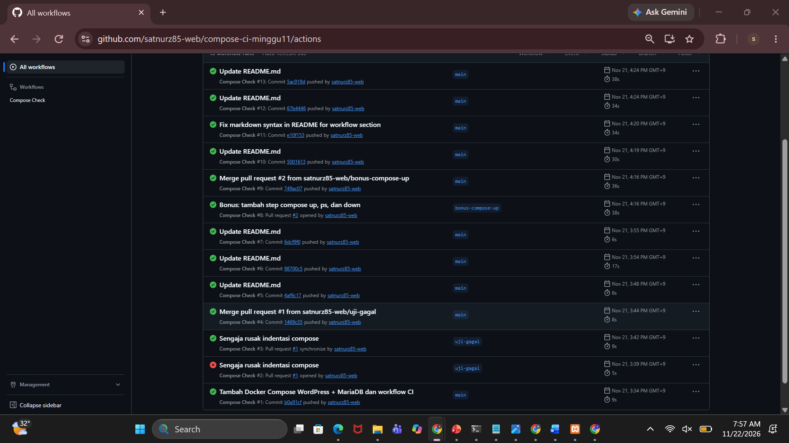
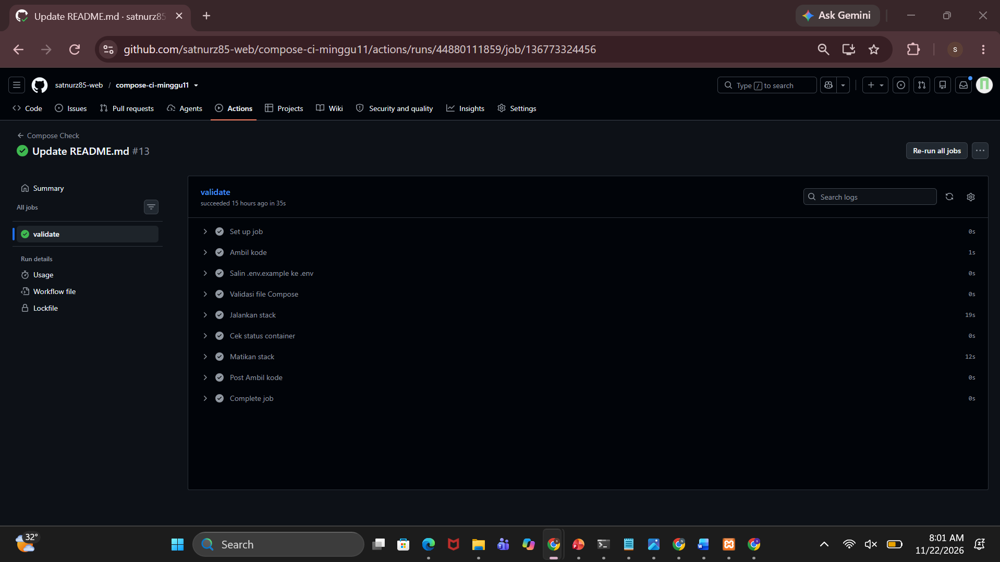
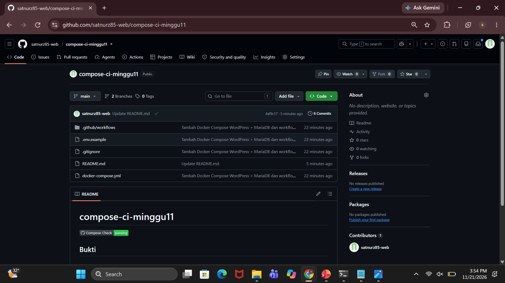

Stack WordPress + MariaDB dengan CI GitHub Actions. Workflow 'compose-check.yml' memvalidasi 'docker-compose.yml' setiap push ke 'main' dan setiap Pull Request.

## Cara menjalankan

```
cp .env.example .env
docker compose up -d
```

Buka http://localhost:8080. Ganti kata sandi di '.env' sebelum dipakai. Untuk mematikan: 'docker compose down'.

## Bukti

### 1. Tab Actions dengan run hijau


### 2. Detail job validate


### 3. Halaman repo dan badge


## Bonus

Run merah dibuat dengan sengaja di Pull Request #1 (indentasi 'docker-compose.yml' dirusak), lalu diperbaiki sampai hijau dan di-merge. Workflow juga menjalankan 'docker compose up -d', 'ps', dan 'down -v'.

## Sumber bantuan

Dibantu Claude (AI) untuk panduan langkah dan penyusunan laporan. Semua perintah saya jalankan sendiri.
